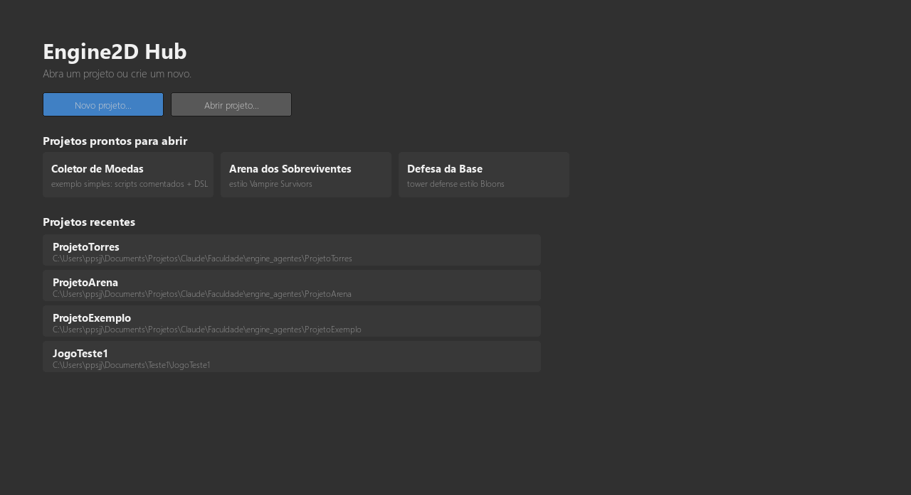
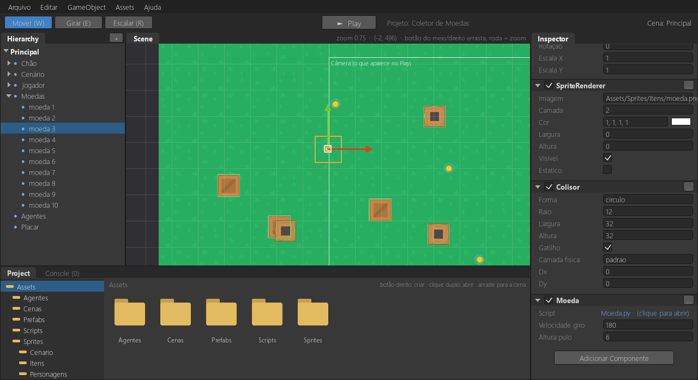
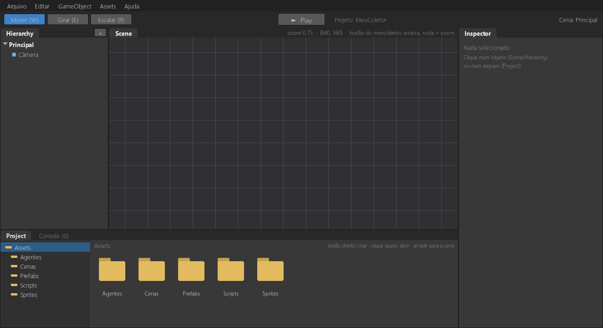
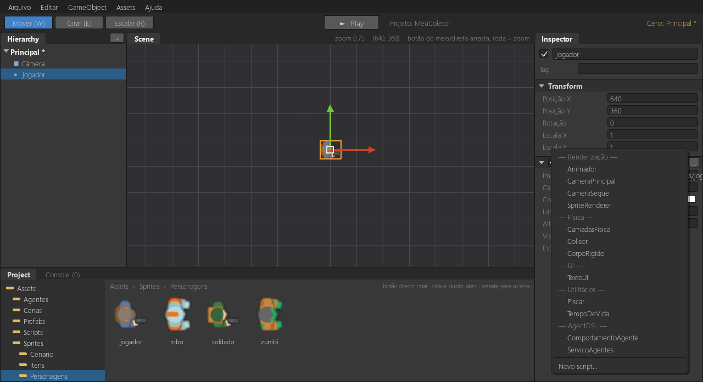
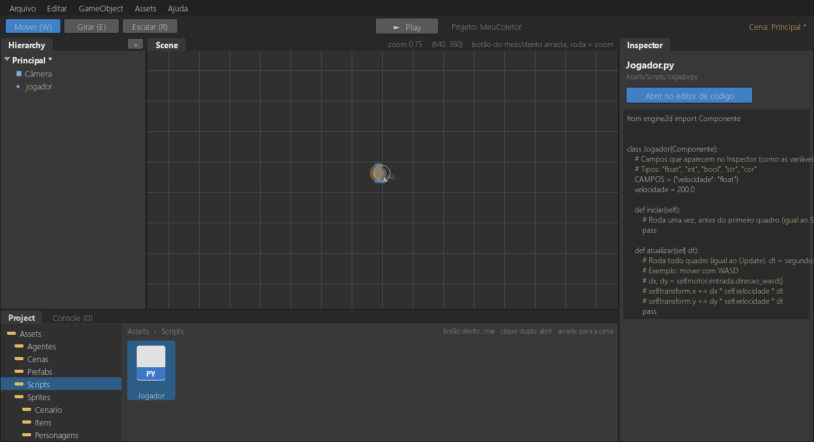
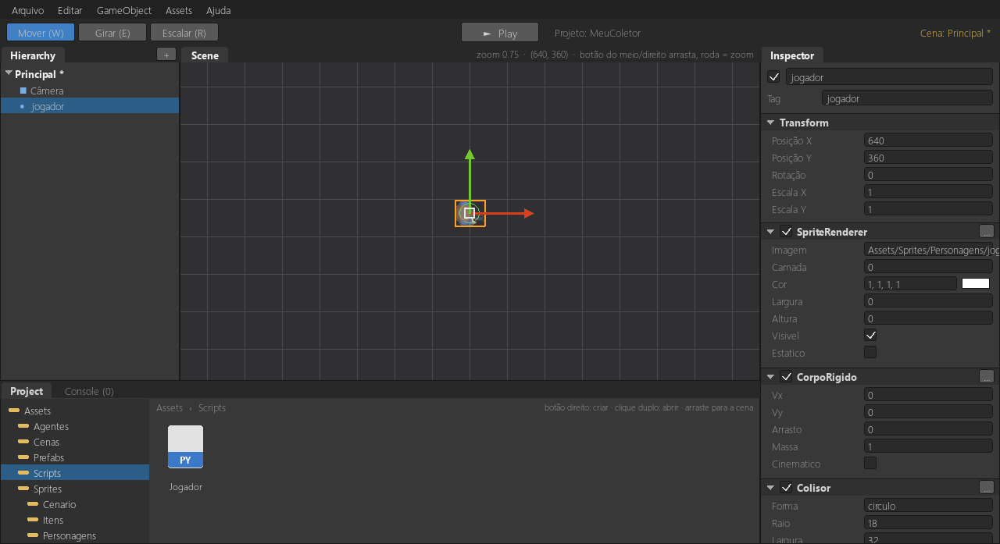
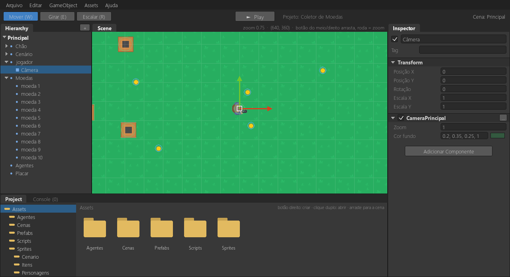
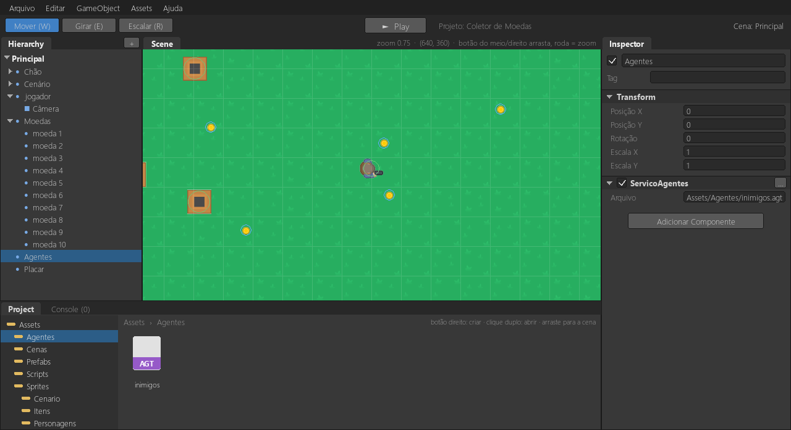
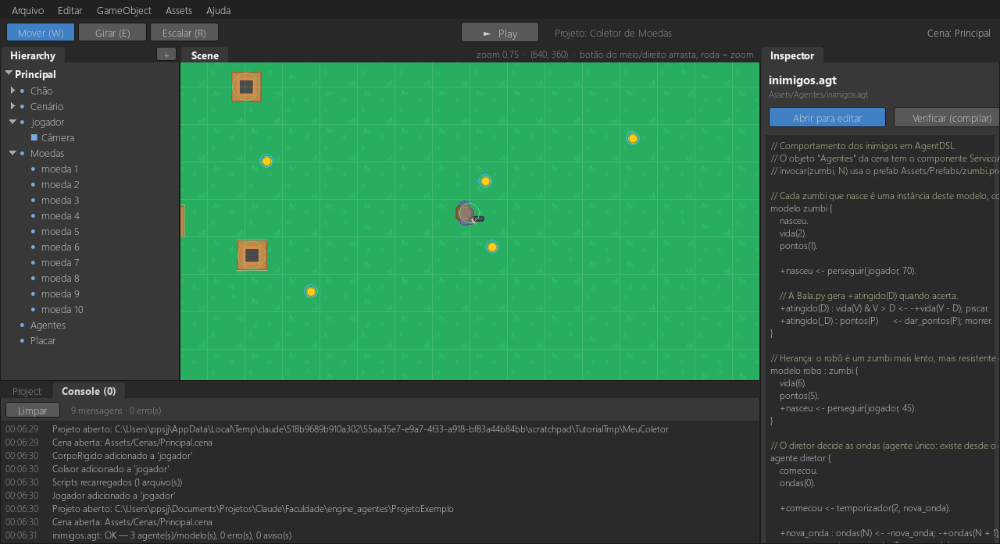
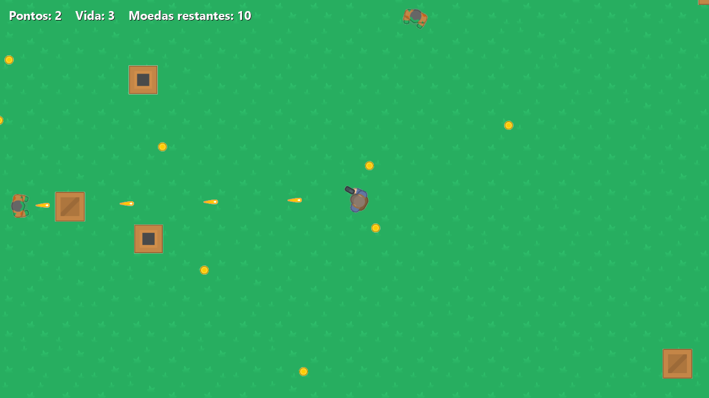

# Tutorial — Engine2D, Editor e AgentDSL

Este tutorial mostra tudo o que dá para fazer com a engine e como fazer, refazendo do zero o
**Coletor de Moedas** (o `ProjetoExemplo`): um personagem que anda com WASD, pega moedas, atira com o
mouse e é perseguido por zumbis cujo comportamento é escrito na **AgentDSL**.

**Sumário**

1. [Instalar e abrir](#1-instalar-e-abrir)
2. [Conhecendo o editor](#2-conhecendo-o-editor)
3. [Conceitos: projeto, cena, objeto, componente](#3-conceitos-projeto-cena-objeto-componente)
4. [Passo a passo: refazendo o Coletor de Moedas](#4-passo-a-passo-refazendo-o-coletor-de-moedas)
5. [A AgentDSL em detalhes](#5-a-agentdsl-em-detalhes)
6. [Referência rápida](#6-referência-rápida)
7. [Problemas comuns](#7-problemas-comuns)
8. [Indo além: os jogos completos](#8-indo-além-os-jogos-completos)

---

## 1. Instalar e abrir

Precisa de Python 3.10 ou mais novo e de uma placa de vídeo com OpenGL 3.3 (qualquer notebook atual tem).

```powershell
cd C:\Users\ppsjj\Documents\Projetos\Claude\Faculdade\engine_agentes
```
```powershell
pip install -r requirements.txt
```
```powershell
python editor.py
```

Abre a tela inicial:



- **Novo projeto...** cria uma pasta de projeto nova.
- **Abrir projeto...** abre uma pasta que já tenha `projeto.json`.
- **Projetos prontos**: o exemplo das moedas e os dois jogos completos.

Também dá para abrir um projeto direto: `python editor.py ProjetoExemplo`.

Para **jogar sem o editor**: `python jogar.py` (menu) ou `python rodar.py ProjetoExemplo`.

---

## 2. Conhecendo o editor



| Painel | Para que serve | Como usar |
|---|---|---|
| **Hierarchy** (esquerda) | Lista os objetos da cena em árvore | Clique seleciona · clique duplo foca · arraste um objeto **sobre** outro para virar filho (solte no vazio para voltar à raiz) · botão direito: criar, renomear, duplicar, salvar como prefab, excluir · botão **+** cria objetos |
| **Scene** (centro) | A cena, para montar com o mouse | Clique seleciona · arraste move · **W/E/R** = mover/girar/escalar (alças coloridas: vermelho = X, verde = Y) · **Ctrl** ao arrastar encaixa na grade · botão do meio ou direito arrasta a visão · roda = zoom · **F** foca no selecionado · o retângulo branco é o que a câmera do jogo vai mostrar |
| **Inspector** (direita) | Propriedades do selecionado | Clique num valor e digite (Enter confirma, Esc cancela) · **arraste sobre o nome** de um número para mudar (Shift = mais rápido) · caixinha ao lado do componente liga/desliga · **…** remove/move/edita o script · **Adicionar Componente** |
| **Project** (embaixo) | Arquivos do projeto (pasta `Assets`) | Clique duplo abre (pasta, cena, script no VS Code) · botão direito: **Criar → Script / Agente DSL / Pasta / Cena**, renomear, excluir · arraste arquivos para a Scene ou para campos do Inspector · arraste arquivos do Windows para dentro do editor para importar |
| **Console** (aba embaixo) | Mensagens, erros e os `print()` do jogo | **Limpar** apaga · erros aparecem em vermelho |
| **► Play** (topo) | Roda a cena numa janela | Ctrl+P também · aperte de novo (**■ Parar**) para fechar |

As bordas entre os painéis podem ser arrastadas para mudar o tamanho deles.

**Atalhos**

| Atalho | Faz |
|---|---|
| Ctrl+S | salvar a cena |
| Ctrl+Z / Ctrl+Y | desfazer / refazer |
| Ctrl+D | duplicar o objeto |
| Del | excluir o objeto (ou o arquivo selecionado no Project) |
| F2 | renomear |
| Ctrl+P | Play / Parar |
| Ctrl+Shift+N | novo objeto vazio |
| W / E / R | mover / girar / escalar |
| F | focar a câmera do editor no objeto |

---

## 3. Conceitos: projeto, cena, objeto, componente

### Projeto

Um projeto é uma pasta:

```
MeuJogo/
  projeto.json          nome, cena inicial, tamanho da janela do jogo
  Assets/
    Cenas/*.cena        as cenas (arquivos JSON)
    Scripts/*.py        seus scripts (componentes em Python)
    Sprites/*.png       imagens
    Prefabs/*.prefab    objetos prontos para copiar
    Agentes/*.agt       comportamentos escritos na AgentDSL
  Library/              arquivos temporários do editor (pode apagar)
```

### Cena, GameObject e Transform

- Uma **cena** é uma lista de **GameObjects** (objetos).
- Todo objeto tem um nome, uma **tag** (rótulo livre, ex.: `moeda`, `inimigo`) e um **Transform**:
  posição (X, Y), rotação (graus) e escala.
- Objetos podem ser **filhos** de outros. A posição do filho é relativa ao pai: se o pai anda, o filho anda junto.
- Coordenadas: X cresce para a direita e **Y cresce para cima**. A unidade é o pixel.

### Componentes

Um objeto sozinho não faz nada. O que ele faz vem dos **componentes** que você adiciona:

| Componente | Faz |
|---|---|
| `SpriteRenderer` | desenha uma imagem (campo `imagem`, ou uma forma `embutido:...`), na `camada_desenho` e `ordem` escolhidas; `virar_x`/`virar_y` espelham |
| `CorpoRigido` | `tipo` **dinamico** (cai com a gravidade e é empurrado), **cinematico** (só anda pela velocidade) ou **estatico**; `escala_gravidade`, `elasticidade` (quique), `velocidade_maxima`; depois da física: `no_chao`, `no_teto`, `na_parede` |
| `Colisor` | forma de colisão: `circulo` (raio) ou `caixa`; `gatilho` = só detecta, não empurra; `so_por_cima` = plataforma que dá para atravessar pulando por baixo; `camada_fisica` = grupo de colisão |
| `MapaTiles` | uma fase feita de blocos numa grade: selecione e **pinte na Scene com a Paleta** do Inspector; junta os blocos sólidos em poucos colisores e cria os prefabs (moedas, inimigos) no Play |
| `CameraPrincipal` | a câmera do jogo: o que ela enxerga é o que aparece na tela (`zoom`, `cor_fundo`) |
| `TextoUI` | um texto fixo na tela (placar, mensagens) |
| `Animador` | troca a imagem em sequência (animação por quadros) |
| `TempoDeVida` | destrói o objeto depois de N segundos (tiros, efeitos) |
| `CameraSegue` | faz a câmera seguir o objeto, com suavização e limites |
| `Piscar` | pisca o sprite (feedback de dano) |
| `CamadasFisica` | diz quais camadas físicas **não** colidem entre si (ex.: `bala:bala`) |
| `EmissorParticulas` | solta partículas (explosões, fogo, faíscas, estrelas): `rajada` de uma vez ou `taxa` por segundo, cores e tamanhos do começo ao fim, `area_largura`/`area_altura` para nascerem numa faixa |
| `FundoRolante` | imagem repetida que cobre uma área e rola sem parar (céu, espaço, chão) |
| `FonteAudio` | toca um som ao iniciar ou quando o script chama `tocar()`; com `musica` vira a música de fundo |
| `ServicoAgentes` | roda um arquivo `.agt` da AgentDSL |
| `ComportamentoAgente` | liga o objeto a um agente da DSL |
| **seus scripts** | qualquer classe Python que você criar em `Assets/Scripts` |

### O que fica na frente (ordem de desenho)

Cada `SpriteRenderer` tem três coisas que decidem quem é desenhado por cima:

1. **Camada de desenho** (`camada_desenho`): uma lista com nome, definida em *Editar → Configurações do
   projeto* (padrão: `Fundo, Padrao, Frente`). A **primeira** da lista fica atrás de todas. No Inspector ela é
   escolhida numa lista (com "Editar camadas...").
2. **Ordem** (`ordem`): um número dentro da camada. Menor = mais atrás (ex.: `-1` fica atrás de `3`).
3. **Hierarchy**: se a camada e a ordem forem iguais, quem está **mais embaixo** na Hierarchy fica na frente.
   Para mudar, arraste o objeto na Hierarchy: soltando na parte de cima ou de baixo de uma linha ele entra
   antes/depois dela (aparece uma linha azul); soltando no meio ele vira filho.

`EmissorParticulas`, `FundoRolante` e `MapaTiles` também têm `camada_desenho`.

### Sprites padrão

*GameObject → 2D: Quadrado / Círculo / Triângulo / Cápsula / Losango / Hexágono / Quadrado arredondado* cria um
objeto com uma forma branca feita pela própria engine (`imagem = "embutido:circulo"`). Mude o campo `cor`
para pintar. Servem para testar ideias antes de ter a arte (blocos, plataformas, inimigos provisórios).

### Iluminação 2D

Adicione o componente **Luz2D** (categoria *Luz*) a um objeto:

| Campo | Faz |
|---|---|
| `tipo` | **global** (luz ambiente da cena toda), **ponto** (em volta, até o `raio`) ou **cone** (lanterna: `angulo` + `abertura`, gira junto com o objeto) |
| `cor`, `intensidade` | a cor da luz e o quanto ela clareia (pode passar de 1) |
| `raio_interno` | até que fração do raio a luz é cheia (depois cai suave até o raio) |
| `sombras` | objetos com **ProjetorSombra2D** bloqueiam esta luz |
| `piscar` | tremulação (fogo, alarme) · `apagar_em`: some aos poucos (clarão de explosão) |

Se a cena tem pelo menos uma Luz2D, o que nenhuma luz alcança fica escuro (só a luz global clareia tudo).
No SpriteRenderer (e nas partículas): **Receber luz** desligado = brilho próprio (tiros, estrelas,
letreiros); **Aditivo** = a cor soma com o fundo (fogo, explosões, escudo). A Scene do editor mostra as luzes
(botão *Luzes: ligadas/desligadas* no alto) e um sol amarelo com o raio de cada luz.

Como funciona no OpenGL: a cada quadro as luzes são desenhadas num **mapa de luz** (framebuffer RGBA16F do
tamanho da tela), que começa com a cor da luz global; cada luz é um quad com queda suave, somado com
`glBlendFunc(GL_ONE, GL_ONE)`. Para as sombras, os **volumes de sombra** dos objetos (do objeto até longe, no
sentido oposto à luz) marcam o **stencil buffer** e a luz só pinta onde o stencil ficou zero. Depois, o
fragment shader de cada sprite multiplica a cor pela luz do seu pixel (`gl_FragCoord`).

### Configurações do projeto

*Editar → Configurações do projeto...* mostra no Inspector o que vale para todas as cenas (salvo em
`projeto.json`): nome, resolução, **gravidade** (jogo de plataforma: `Y = -1800`; jogo visto de cima: `0`),
**camadas de desenho**, **tags** (a tag do objeto é escolhida numa lista; "Nova tag..." cria outra) e os pares
de camadas físicas que **não colidem** (ex.: `tiro:tiro, item:inimigo`).

### Prefab

Um **prefab** é um objeto salvo como arquivo (`.prefab`), para criar cópias. Para criar um, arraste o objeto
da Hierarchy para o painel Project (ou botão direito → *Salvar como prefab*). Para usar, arraste o `.prefab`
para a Scene, ou crie pelo código com `self.cena.instanciar("Assets/Prefabs/bala.prefab", x, y)`.

> Os scripts são em Python e a cena é salva num JSON legível (dá para abrir e ler o arquivo .cena).

---

## 4. Passo a passo: refazendo o Coletor de Moedas

### 4.1 Criar o projeto

1. Na tela inicial: **Novo projeto...**, escolha uma pasta (ex.: Documentos) e dê o nome `MeuColetor`.
2. O editor abre o projeto com a cena `Principal`, que já tem um objeto **Câmera**.



### 4.2 Trazer as imagens

Arraste arquivos `.png` do Windows Explorer para dentro da janela do editor: eles são copiados para a pasta
aberta no Project. Também funciona **Assets → Importar imagens...**.

Para este tutorial, copie a pasta `ProjetoExemplo\Assets\Sprites` para dentro de `MeuColetor\Assets\`.
Ela tem `Personagens/jogador.png`, `zumbi.png`, `robo.png`, `Itens/moeda.png`, `bala.png` etc.

### 4.3 Fundo e câmera

Selecione o objeto **Câmera** e, no Inspector, mude `Cor fundo` para `0.2, 0.35, 0.25, 1` (um verde).
Os quatro números são vermelho, verde, azul e transparência, de 0 a 1.

> No exemplo pronto, o chão é feito de vários tiles de grama, todos filhos de um objeto "Chão" e marcados
> como `Estatico` (o campo do SpriteRenderer que avisa que o objeto não se move, deixando o jogo mais leve).

### 4.4 O jogador

1. No Project, abra `Sprites/Personagens` e **arraste `jogador.png` para a Scene**. Nasce um objeto `jogador` com SpriteRenderer.
2. No Inspector, ponha a **Tag** `jogador` e a **Camada** do SpriteRenderer em `4`.
3. Clique em **Adicionar Componente** e escolha **CorpoRigido**. Mude `Massa` para `3`.
4. **Adicionar Componente → Colisor**: `Raio` = `18`, `Camada fisica` = `jogador`.



### 4.5 Primeiro script: andar com WASD

1. No Project, **botão direito na pasta `Scripts` → Criar Script**, nome `Jogador`.
2. Clique duas vezes no arquivo: ele abre no VS Code (ou no Bloco de Notas) já com um modelo.



3. Troque o conteúdo por:

```python
from engine2d import Componente, CorpoRigido


class Jogador(Componente):
    # Campos que aparecem no Inspector para editar
    CAMPOS = {"velocidade": "float"}
    velocidade = 220.0

    def iniciar(self):                       # roda uma vez no começo
        self.corpo = self.obter(CorpoRigido)  # o CorpoRigido deste mesmo objeto

    def atualizar(self, dt):                 # roda todo quadro; dt = segundos
        dx, dy = self.motor.entrada.direcao_wasd()
        self.corpo.vx = dx * self.velocidade
        self.corpo.vy = dy * self.velocidade
```

4. **Salve o arquivo.** O editor percebe e recarrega o script sozinho (aparece no Console).
5. Selecione o jogador → **Adicionar Componente → Scripts → Jogador**.
6. Aperte **► Play**. O jogo abre numa janela e o personagem anda com WASD.



> **Dica:** o campo `Velocidade` apareceu no Inspector porque está em `CAMPOS`. Mude o valor lá e dê Play
> de novo, sem mexer no código. Os tipos aceitos são `"float"`, `"int"`, `"bool"`, `"str"` e `"cor"`.

### 4.6 A câmera seguindo o jogador

Na Hierarchy, **arraste o objeto `Câmera` para cima do `jogador`**. A câmera vira filha dele e passa a
acompanhá-lo. Selecione a Câmera e, no Inspector, ponha `Posição X` e `Posição Y` em `0`: num filho, a
posição é **relativa ao pai**, então `0, 0` quer dizer "no centro do jogador".



### 4.7 As moedas

1. Arraste `Itens/moeda.png` para a Scene. Ponha a **Tag** `moeda`.
2. **Adicionar Componente → Colisor**: `Raio` = `12` e marque **Gatilho**, porque a moeda não deve empurrar ninguém, só avisar que foi tocada.
3. Crie o script **Moeda** (gira e flutua):

```python
import math

from engine2d import Componente


class Moeda(Componente):
    CAMPOS = {"velocidade_giro": "float", "altura_pulo": "float"}
    velocidade_giro = 180.0
    altura_pulo = 6.0

    def iniciar(self):
        self.y_inicial = self.transform.y
        self.tempo = 0.0

    def atualizar(self, dt):
        self.tempo += dt
        self.transform.rotacao += self.velocidade_giro * dt
        self.transform.y = self.y_inicial + math.sin(self.tempo * 4) * self.altura_pulo
```

4. Adicione o script Moeda à moeda. Depois **Ctrl+D** várias vezes e espalhe as cópias com o mouse.
   Para organizar, crie um objeto vazio `Moedas` (GameObject → Criar vazio) e arraste as moedas para dentro dele.


### 4.8 Pegar as moedas (colisão)

Quando dois colisores se encostam, a engine chama `ao_entrar_colisao(self, outro)` nos scripts dos dois
objetos. `outro` é o Colisor do outro objeto. Acrescente ao `Jogador`:

```python
    def iniciar(self):
        self.corpo = self.obter(CorpoRigido)
        self.pontos = 0

    def ao_entrar_colisao(self, outro):          # quando encosta em outro colisor
        objeto = outro.gameobject
        if objeto.tag == "moeda":
            self.pontos += 1
            objeto.destruir()                    # = Destroy(gameObject)
            print(f"Pegou uma moeda! Pontos: {self.pontos}")
```

Dê Play e pegue uma moeda: o `print` aparece no **Console** do editor.

### 4.9 O placar na tela

1. **GameObject → Texto (UI)**. Renomeie para `Placar` (F2). No `TextoUI`: `Tamanho` = `22`, `Negrito` marcado.
2. Crie o script **Placar** e adicione ao objeto:

```python
from engine2d import Componente, TextoUI


class Placar(Componente):
    def iniciar(self):
        self.texto = self.obter(TextoUI)

    def atualizar(self, dt):
        jogador = self.cena.encontrar("jogador")         # acha o objeto pelo nome
        if jogador is None:
            return
        j = jogador.obter("Jogador")                      # pode buscar o componente pelo nome
        moedas = len(self.cena.com_tag("moeda"))          # quantos objetos com a tag "moeda"
        self.texto.texto = f"Pontos: {j.pontos}    Moedas restantes: {moedas}"
```

> Outra forma de desenhar na tela é o método `desenhar_ui(self, ui)` (roda todo quadro):
> `ui.texto(x, y, "oi", 20)`, `ui.barra(...)`, `ui.botao(...)`. Veja a [referência](#interface-desenhar_ui).

### 4.10 Atirar com o mouse (prefab + Instantiate)

**a) O prefab da bala**

1. Arraste `Itens/bala.png` para a Scene (nasce o objeto `bala`). Escala `0.7`, camada `5`, tag `bala`.
2. Adicione: **CorpoRigido** (marque `Cinematico`, para ninguém empurrar a bala), **Colisor** (`Raio` 8,
   `Gatilho` marcado, `Camada fisica` = `bala`) e **TempoDeVida** (`Segundos` = 1.5, para ela sumir sozinha).
3. Crie o script **Bala** e adicione:

```python
from engine2d import Componente


class Bala(Componente):
    CAMPOS = {"dano": "int"}
    dano = 1

    def ao_entrar_colisao(self, outro):
        objeto = outro.gameobject
        if objeto.tag != "inimigo":
            return
        agente = objeto.obter("ComportamentoAgente")
        if agente is not None:
            agente.pulsar("atingido", (self.dano,))   # avisa o inimigo (a DSL decide o que acontece)
        self.gameobject.destruir()
```

4. Deixe o Project aberto na pasta `Prefabs` e **arraste o objeto `bala` da Hierarchy para o Project**.
   Nasce `bala.prefab`. Agora apague a bala da cena (Del).

**b) Atirar no Jogador**

Esta é a versão final do `Jogador.py`, com mira e tiro (é a mesma do ProjetoExemplo):

```python
import math

from engine2d import Componente, CorpoRigido


class Jogador(Componente):
    CAMPOS = {"velocidade": "float", "vida": "int", "intervalo_tiro": "float", "velocidade_bala": "float"}
    velocidade = 220.0
    vida = 3
    intervalo_tiro = 0.25
    velocidade_bala = 650.0

    def iniciar(self):
        self.corpo = self.obter(CorpoRigido)
        self.pontos = 0
        self.invencivel = 0.0
        self.recarga = 0.0

    def atualizar(self, dt):
        entrada = self.motor.entrada
        dx, dy = entrada.direcao_wasd()
        self.corpo.vx = dx * self.velocidade
        self.corpo.vy = dy * self.velocidade
        mx, my = entrada.mouse_mundo             # mouse no mundo (já considera a câmera)
        self.transform.olhar_para(mx, my)        # gira o personagem para o mouse
        self.recarga = max(0.0, self.recarga - dt)
        if entrada.mouse_pressionado(1) and self.recarga <= 0:   # botão esquerdo
            self.atirar(mx, my)
            self.recarga = self.intervalo_tiro
        self.invencivel = max(0.0, self.invencivel - dt)

    def atirar(self, mx, my):
        x, y = self.transform.posicao_mundo
        angulo = math.degrees(math.atan2(my - y, mx - x))
        bala = self.cena.instanciar("Assets/Prefabs/bala.prefab", x, y)    # cópia do prefab
        bala.transform.rotacao = angulo
        corpo_bala = bala.obter("CorpoRigido")
        corpo_bala.vx = math.cos(math.radians(angulo)) * self.velocidade_bala
        corpo_bala.vy = math.sin(math.radians(angulo)) * self.velocidade_bala

    def ao_entrar_colisao(self, outro):
        objeto = outro.gameobject
        if objeto.tag == "moeda":
            self.pontos += 1
            objeto.destruir()
            print(f"Pegou uma moeda! Pontos: {self.pontos}")
        elif objeto.tag == "inimigo" and self.invencivel <= 0:
            self.vida -= 1
            self.invencivel = 1.0
            print(f"Ai! Vida: {self.vida}")
            if self.vida <= 0:
                print("Fim de jogo — reiniciando a cena")
                self.motor.trocar_cena(self.cena.servicos["fabrica"])
```

### 4.11 Inimigos com a AgentDSL

Agora os zumbis. Em vez de escrever o comportamento em Python, ele vai num arquivo `.agt` da **AgentDSL**
(a linguagem que fizemos para a disciplina de Compiladores). A ideia é descrever **regras**:
*"quando acontecer X, se Y for verdade, faça Z"*.

**a) O prefab do zumbi**

1. Arraste `Personagens/zumbi.png` para a Scene. Tag `inimigo`, camada 3.
2. Adicione **CorpoRigido** (zumbis empurram uns aos outros), **Colisor** (`Raio` 18, `Camada fisica` = `inimigo`) e **Piscar**.
3. Arraste para `Assets/Prefabs` → nasce `zumbi.prefab`. Apague o zumbi da cena.

> **Regra importante:** o nome do prefab tem que ser **igual ao nome do modelo** no `.agt`. É assim que
> `invocar(zumbi, 3)` sabe que deve usar `Assets/Prefabs/zumbi.prefab`.

**b) O arquivo de comportamento**

No Project, botão direito em `Agentes` → **Criar Agente DSL**, nome `inimigos`, e escreva:

```
// Cada zumbi que nasce é uma instância deste modelo.
modelo zumbi {
    nasceu.                              // crença inicial
    +nasceu <- perseguir(jogador, 70).   // quando "nasceu" passa a ser verdade: persegue o jogador
}

// O diretor cria os zumbis (agente único: existe desde o começo do jogo).
agente diretor {
    comecou.
    ondas(0).

    +comecou <- temporizador(2, nova_onda).          // daqui a 2 s, acredita em "nova_onda"

    +nova_onda : ondas(N) <- -nova_onda; -+ondas(N + 1); invocar(zumbi, 1 + N / 2);
                             temporizador(5, nova_onda).    // e de novo daqui a 5 s
}
```

**c) Ligar o arquivo à cena**

1. Crie um objeto vazio `Agentes` e adicione **ServicoAgentes**.
2. Arraste o arquivo `inimigos.agt` do Project para o campo **Arquivo** do componente.



3. Selecione `inimigos.agt` no Project e clique em **Verificar (compilar)**. O compilador da DSL roda e
   mostra os erros, ou "OK", no Console:



4. O compilador vai **avisar** que não conhece o nome `jogador` usado em `perseguir(jogador, 70)`. Não é
   erro (o jogo roda), mas é bom declarar os nomes válidos. Crie o script **AcoesDSL** (o próximo passo
   completa ele):

```python
from engine2d.projeto import alvo_dsl

alvo_dsl("jogador")
```

5. **► Play**: a cada 5 segundos nascem zumbis, cada vez mais, perseguindo o jogador.

### 4.12 Dar vida aos zumbis (DSL + Python conversando)

A `Bala` já faz `agente.pulsar("atingido", (1,))`, que coloca no zumbi a crença `atingido(1)` por um
instante e gera o **evento** `+atingido(1)`. Falta o zumbi reagir. Complete o `inimigos.agt`:

```
modelo zumbi {
    nasceu.
    vida(2).
    pontos(1).

    +nasceu <- perseguir(jogador, 70).

    // Levou D de dano. Se a vida V for maior que D: perde vida e pisca.
    +atingido(D) : vida(V) & V > D <- -+vida(V - D); piscar.
    // Senão (o primeiro plano não serviu): dá pontos e morre.
    +atingido(_D) : pontos(P)      <- dar_pontos(P); morrer.
}
```

`dar_pontos` não existe na engine: é uma **ação nova**, criada em Python. Complete o `AcoesDSL.py`:

```python
from engine2d.projeto import acao_dsl, alvo_dsl, percepcao_dsl

percepcao_dsl("atingido", "num")      # a Bala coloca a crença atingido(N) nos inimigos
alvo_dsl("jogador")


@acao_dsl("dar_pontos", "num", descricao="soma pontos ao jogador")
def dar_pontos(corpo, agente, quantidade):
    # corpo = o ComportamentoAgente do zumbi; agente = o agente da DSL
    jogador = corpo.cena.encontrar("jogador")
    if jogador is not None:
        jogador.obter("Jogador").pontos += int(quantidade)
```

Clique em **Verificar** de novo. Se você escrever `dar_pontos(P, 2)`, por exemplo, o compilador acusa:
*"'dar_pontos' espera 1 argumento(s), recebeu 2"*.

### 4.13 Um inimigo novo com herança

```
// O robô herda tudo do zumbi e muda só o que precisa.
modelo robo : zumbi {
    vida(6).
    pontos(5).
    +nasceu <- perseguir(jogador, 45).
}
```

Crie o prefab `robo.prefab` (igual ao do zumbi, com `robo.png` e escala 1.3) e acrescente ao diretor:

```
    +ondas(N) : N > 0 & N % 4 == 0 <- invocar(robo, 1); avisar("Um robô apareceu!").
```

`avisar` é mais uma ação criada em Python. Acrescente ao `AcoesDSL.py`:

```python
@acao_dsl("avisar", "texto", descricao="mostra uma mensagem grande na tela")
def avisar(corpo, agente, mensagem):
    placar = corpo.cena.encontrar("Placar")
    if placar is not None:
        placar.obter("Placar").avisar(mensagem)
    print("[DSL]", mensagem)
```

E dê ao `Placar` o método `avisar` e um `desenhar_ui` que mostra a mensagem por 2,5 segundos:

```python
from engine2d import Componente, TextoUI


class Placar(Componente):
    def iniciar(self):
        self.texto = self.obter(TextoUI)
        self.aviso = ""
        self.tempo_aviso = 0.0

    def atualizar(self, dt):
        jogador = self.cena.encontrar("jogador")
        if jogador is None:
            return
        j = jogador.obter("Jogador")
        moedas = len(self.cena.com_tag("moeda"))
        self.texto.texto = f"Pontos: {j.pontos}    Vida: {j.vida}    Moedas restantes: {moedas}"
        self.tempo_aviso = max(0.0, self.tempo_aviso - dt)

    def avisar(self, mensagem):
        self.aviso = mensagem
        self.tempo_aviso = 2.5

    def desenhar_ui(self, ui):
        if self.tempo_aviso > 0:
            ui.texto(ui.largura / 2, 90, self.aviso, 30, cor=(255, 210, 80), ancora="center", negrito=True)
```

### 4.14 Salvar e rodar

- **Ctrl+S** salva a cena. **Arquivo → Definir como cena inicial** escolhe a cena que abre no jogo.
- Para rodar sem o editor, passe a pasta do projeto: `python rodar.py C:\Users\voce\Documents\MeuColetor`.



Pronto: você refez o `ProjetoExemplo`. Compare com ele se algo não funcionar.

---

## 5. A AgentDSL em detalhes

### 5.1 A ideia

Cada **agente** tem uma lista de coisas em que ele acredita: as **crenças**. Exemplos: `vivo`,
`vida(3)`, `jogador_perto`.

Sempre que uma crença **entra** na lista, acontece o evento `+crença`; quando ela **sai**, acontece
`-crença`. Os **planos** dizem o que fazer em cada evento:

```
+evento : contexto <- ação1; ação2; ação3.
```

Lê-se: *"quando acontecer **evento**, se o **contexto** for verdade, faça as **ações**"*.

Isso vem do AgentSpeak/Jason (modelo BDI de agentes). A vantagem é que você não precisa guardar "o valor
do quadro anterior" para saber se algo mudou: a mudança já é o evento.

### 5.2 Estrutura de um arquivo

```
// comentário de uma linha        /* comentário de várias linhas */

agente nome {          // agente único: é criado quando o jogo começa
    crenças...
    planos...
}

modelo nome {          // TIPO de agente: o jogo cria quantos quiser (cada inimigo, cada torre)
    crenças...
    planos...
}

modelo filho : pai {   // herança: copia crenças e planos do pai; os planos do filho têm prioridade
    ...
}
```

### 5.3 Crenças

```
vivo.                  // sem argumentos
vida(3).               // com um número
posicao(100, 200).     // vários argumentos
estado(normal).        // átomo (nome em minúsculas)
nome("Zé").            // texto
```

As crenças escritas no corpo do agente são as **iniciais**, e cada uma gera um evento `+` quando o agente
nasce. Por isso `+nasceu <- ...` roda logo no começo.

### 5.4 Eventos e planos

| Evento | Quando acontece |
|---|---|
| `+b` | a crença `b` foi adicionada (e antes não existia) |
| `-b` | a crença `b` foi removida |

Para cada evento, os planos são testados **na ordem em que aparecem no arquivo**. O primeiro cujo evento
combina **e** cujo contexto é verdadeiro é executado. Os outros são ignorados. Use isso para fazer
"se / senão":

```
+atingido(D) : vida(V) & V > D <- -+vida(V - D).     // se tem vida sobrando
+atingido(_D)                  <- morrer.             // senão
```

### 5.5 Variáveis

- Começam com **letra maiúscula**: `V`, `D`, `Alvo`.
- Uma variável recebe valor no **evento** ou num item do **contexto**, e depois pode ser usada nas ações.
- Começar com `_` (ex.: `_D`) diz "não vou usar essa"; sem isso, o compilador avisa.

```
+atingido(D) : vida(V) & V > D <- -+vida(V - D).
//        ^ D vem do evento   ^ V vem da crença vida(V)
```

### 5.6 Contexto (a condição)

| Escrita | Significa |
|---|---|
| `vivo` | a crença `vivo` existe |
| `vida(V)` | existe uma crença `vida(...)`; `V` recebe o valor |
| `nao escudo` | a crença `escudo` **não** existe |
| `V > 2`, `V <= D`, `X == jogador`, `N != 0` | comparações |
| `A & B & C` | todas verdadeiras ("e") |
| `verdadeiro` | sempre |

Contas: `+ - * /` e `%` (resto da divisão). Exemplo: `S % 20 == 0` é verdade a cada 20 segundos.

### 5.7 Ações

**Mudar as próprias crenças** (gera novos eventos):

| Ação | Faz |
|---|---|
| `+b` | adiciona a crença `b` |
| `-b` | remove a crença `b` |
| `-+vida(V - 1)` | troca: remove todas as `vida(...)` e adiciona `vida(V - 1)` |

**Ações da engine** (funcionam em qualquer projeto):

| Ação | Faz |
|---|---|
| `mover(dx, dy)` / `posicionar(x, y)` | desloca uma vez / coloca numa posição |
| `velocidade(vx, vy)` / `inverter` / `parar` | movimento contínuo (pixels por segundo) |
| `perseguir(alvo, v)` / `fugir(alvo, v)` | anda em direção a / para longe de um objeto pelo nome |
| `rotacionar(g)` / `girar(g_por_s)` / `escalar(f)` | gira uma vez / gira sem parar / multiplica a escala |
| `cor(r, g, b)` / `piscar` / `mudar_camada(n)` | aparência (cores de 0 a 1) |
| `trocar_imagem("Assets/Sprites/x.png")` / `sumir` / `aparecer` | sprite |
| `temporizador(seg, crença)` | depois de `seg` segundos, adiciona a crença (vira um evento `+crença`) |
| `invocar(modelo, n)` | cria `n` objetos do modelo (usa `Assets/Prefabs/modelo.prefab`), na borda da tela |
| `invocar_aqui(modelo, n)` | cria `n` na posição de quem invocou (ex.: um tanque que vira soldados) |
| `invocar_serie(modelo, n, intervalo)` | cria `n`, um a cada `intervalo` segundos |
| `morrer` | destrói o objeto (e o agente) |
| `imprimir("texto", V, ...)` | escreve no log (aparece no Console e no canto da tela) |

### 5.8 Como o jogo conversa com a DSL

**Do Python para a DSL (percepções)**: pegue o componente `ComportamentoAgente` do objeto e use:

```python
agente = objeto.obter("ComportamentoAgente")

agente.pulsar("atingido", (5,))         # crença instantânea: entra agora, sai no próximo quadro
agente.perceber({("jogador_perto", ())})  # lista do que é verdade AGORA; só as mudanças viram eventos
agente.perceber(set())                  # nada é verdade → gera -jogador_perto
agente.crenca_num("alcance", 100)       # lê uma crença numérica, ex.: alcance(250) → 250
agente.ag.adicionar("nivel", (2,))      # mexe direto nas crenças (gera o evento +nivel(2))
```

Use `pulsar` para acontecimentos (levou um tiro, bateu na parede) e `perceber` para estados (está perto, está
tocando). Toda percepção usada no `.agt` precisa ser declarada num script, para o compilador conhecer:

```python
from engine2d.projeto import percepcao_dsl
percepcao_dsl("atingido", "num")     # nome e tipos dos argumentos
percepcao_dsl("jogador_perto")       # sem argumentos
```

**Da DSL para o Python (ações novas)**:

```python
from engine2d.projeto import acao_dsl, alvo_dsl

alvo_dsl("jogador", "base")          # nomes que podem aparecer como alvo nas ações

@acao_dsl("explodir", "num", "num", descricao="dano em área")
def explodir(corpo, agente, dano, raio):
    x, y = corpo.transform.posicao_mundo
    # ... qualquer código Python ...
```

Os tipos dos argumentos são `"num"`, `"atomo"` e `"texto"`. O compilador confere a quantidade e o tipo dos
argumentos em todo lugar onde a ação é usada.

### 5.9 Quando cada coisa roda

A cada quadro do jogo, nesta ordem:

1. os scripts rodam `atualizar(dt)` e geram as percepções (por exemplo, a `Bala` acerta e chama `pulsar`);
2. o `ServicoAgentes` processa os eventos de todos os agentes: escolhe os planos e executa as ações;
3. a física move os objetos e detecta as colisões;
4. tudo é desenhado.

Cada agente processa no máximo 64 eventos por quadro, então um plano que se chama sem parar não trava o jogo.

### 5.10 Erros que o compilador encontra

Clique em **Verificar** no Inspector do `.agt` (ou rode `python -m agentdsl verificar caminho/arquivo.agt`):

| Tipo | Exemplo de mensagem |
|---|---|
| léxico | `caractere inválido '@'` · `texto não fechado (faltou ")` · `número malformado '12abc'` |
| sintático | `esperava '<-' entre o evento/contexto e as ações, encontrou 'velocidade'` |
| semântico | `ação desconhecida 'velocidad' (quis dizer 'velocidade'?)` |
| semântico | `variável 'Y' usada em 'mover' sem estar ligada no evento ou no contexto` |
| semântico | `'mover' espera 2 argumento(s), recebeu 1` · `argumento 1 de 'girar' deveria ser num, mas 'rapido' é atomo` |
| semântico | `modelo 'fantasma' não foi declarado` · `'diretor' é um agente único, não um modelo` |
| aviso | `o evento '+voando' nunca será gerado` (ninguém adiciona essa crença) |

Outros comandos úteis: `python -m agentdsl tokens arquivo.agt` (tokens), `python -m agentdsl ast arquivo.agt`
(árvore sintática) e `python -m agentdsl simbolos arquivo.agt` (tabela de símbolos). A gramática completa
está em [GRAMATICA.md](GRAMATICA.md).

### 5.11 Receitas

```
// Patrulhar e voltar quando bater na parede (um script seu precisa pulsar "borda")
+vivo <- velocidade(80, 0).
+borda <- inverter.

// Atirar a cada 1,5 s enquanto o jogador estiver perto (atirar_no_jogador é criada em Python, veja o ProjetoArena)
+jogador_perto <- +mirando; temporizador(0.5, disparo).
-jogador_perto <- -mirando.
+disparo : mirando <- -disparo; atirar_no_jogador(10, 300); temporizador(1.5, disparo).
+disparo <- -disparo.

// Chefe com duas fases
+atingido(D) : vida(V) & V - D < 500 & fase(1) <- -+fase(2); -+vida(V - D); cor(1, 0.4, 0.4).

// Melhoria de uma torre/arma: o jogo troca nivel(1) por nivel(2)
+nivel(2) <- -+cadencia(0.5); -+dano(3).

// Inimigo que se divide ao morrer (estilo Bloons)
+atingido(D) : vida(V) & V <= D <- invocar_aqui(soldado, 3); morrer.
```

---

## 6. Referência rápida

### Dentro de um script (`self` é o componente)

| Código | Faz |
|---|---|
| `self.transform.x`, `.y`, `.rotacao`, `.escala_x`, `.escala_y` | pose local (relativa ao pai) |
| `self.transform.posicao_mundo` | posição no mundo (pode ler e atribuir) |
| `self.transform.olhar_para(x, y)` | gira para apontar para um ponto |
| `self.gameobject` | o objeto (`.nome`, `.tag`, `.ativo`, `.filhos`, `.pai`) |
| `self.obter(CorpoRigido)` ou `self.obter("Jogador")` | outro componente do mesmo objeto |
| `self.gameobject.destruir()` | destrói o objeto no fim do quadro |
| `self.cena.encontrar("nome")` | acha um objeto pelo nome |
| `self.cena.com_tag("inimigo")` | lista de objetos com a tag |
| `self.cena.instanciar("Assets/Prefabs/x.prefab", x, y)` | cria a partir de um prefab |
| `self.cena.criar("nome", x, y, componentes=[...])` | cria um objeto por código |
| `self.cena.fisica.consultar_circulo(x, y, raio, camada="inimigo")` | colisores dentro de um círculo |
| `self.motor.trocar_cena("Assets/Cenas/Fase1.cena")` | troca de cena no próximo quadro (aceita também uma função que cria a cena) |
| `self.motor.reiniciar_cena()` | recarrega a cena atual do arquivo (jogar de novo) |
| `self.motor.tremer(8, 0.3)` | faz a tela tremer (força em pixels, duração em segundos) |
| **F3** em qualquer jogo | painel com FPS, tempos, sprites desenhados/descartados, draw calls, luzes, sombras, física e eventos da DSL |
| `self.motor.audio.tocar("Assets/Sons/x.ogg", volume=0.5)` | toca um efeito sonoro |
| `self.motor.audio.musica("Assets/Sons/tema.ogg")` | música de fundo (repete) |
| `print(...)` | aparece no Console |

### Métodos que você pode escrever

| Método | Quando roda |
|---|---|
| `iniciar(self)` | uma vez, antes do primeiro quadro |
| `atualizar(self, dt)` | todo quadro |
| `atualizar_tardio(self, dt)` | todo quadro, depois de todos os `atualizar` |
| `ao_entrar_colisao(self, outro)` | começou a encostar |
| `ao_sair_colisao(self, outro)` | parou de encostar |
| `desenhar_ui(self, ui)` | todo quadro, para desenhar na tela |
| `ao_destruir(self)` | quando o objeto é destruído |

### Entrada (`self.motor.entrada`)

| Código | Faz |
|---|---|
| `tecla("space")` | tecla está pressionada (nomes: `"a"`, `"left"`, `"left shift"`, `"return"`...) |
| `tecla_baixou("e")` / `tecla_soltou("e")` | apertou / soltou neste quadro |
| `direcao_wasd()` | `(dx, dy)` de WASD ou setas, já normalizado |
| `mouse_mundo` / `mouse_tela` | posição do mouse no mundo / em pixels da janela |
| `mouse_pressionado(1)` / `clicou(1)` | botão segurado / clicado neste quadro (1 = esquerdo, 3 = direito) |

### Interface (`desenhar_ui`)

```python
def desenhar_ui(self, ui):
    ui.texto(20, 20, "Vida", 18, cor=(255, 255, 255), negrito=True)
    ui.texto(20, 40, "00100", 18, fonte="Assets/Fontes/minha.ttf")   # fonte .ttf do projeto
    ui.barra((20, 45, 200, 12), self.vida / 100)            # barra de 0 a 1
    if ui.botao((20, 70, 120, 32), "Reiniciar"):            # devolve True quando clicado
        self.motor.trocar_cena(self.cena.servicos["fabrica"])
    x, y = ui.mundo_para_tela(*self.transform.posicao_mundo) # para escrever em cima de um objeto
```

### Física

- Um objeto precisa de **Colisor** para colidir e de **CorpoRigido** para se mover por velocidade.
- **Gatilho** = detecta sem empurrar (moedas, tiros, áreas).
- **Dinâmico** = cai com a gravidade do projeto e para em cima do chão (personagem, inimigos que andam).
  **Cinemático** = não cai nem é empurrado (tiros, plataformas que andam). **Estático** = não se mexe.
- Jogo de plataforma: no script, mude só `rb.vx` (andar) e `rb.vy = 800` (pular, se `rb.no_chao`). A física cuida
  do chão e das paredes. `self.cena.fisica.lancar_raio(x, y, 0, -1, 30)` diz se tem chão logo abaixo de um ponto.
- Corpos rápidos não atravessam paredes: a física divide o quadro em passos menores quando precisa.
- **Camada física**: um nome livre. Para duas camadas não colidirem, crie um objeto com **CamadasFisica** e
  escreva no campo `Ignorar`: `bala:bala, bala:jogador`.

---

## 7. Problemas comuns

| Problema | Solução |
|---|---|
| O script não aparece em *Adicionar Componente* | Veja o Console: provavelmente há um erro no script. A classe precisa herdar de `Componente`. |
| O componente ficou com o nome em vermelho | O script tem erro ou foi apagado. Os valores ficam guardados: corrija o script e salve. |
| A imagem não aparece | O campo `imagem` precisa do caminho a partir da pasta do projeto, ex.: `Assets/Sprites/x.png`. Arraste a imagem do Project para o campo (ou para qualquer lugar do Inspector, ou para o objeto na Hierarchy), que ele preenche certo. |
| Aparece um xadrez rosa e preto | É o sinal de "imagem que falta": o campo `imagem` está vazio ou aponta para um arquivo que não existe. |
| A colisão não acontece | Os **dois** objetos precisam de Colisor. Confira se as camadas não estão em `CamadasFisica`. |
| `invocar(zumbi, 1)` não cria nada | Precisa existir `Assets/Prefabs/zumbi.prefab` (mesmo nome do modelo). |
| A ação da DSL dá "ação desconhecida" | Ações novas precisam de `@acao_dsl` num script, e o script precisa carregar sem erro. |
| O Play abre e fecha | Veja o Console: o erro do jogo aparece lá. |
| Errei algo na cena | Ctrl+Z. |

---

## 8. Indo além: os jogos completos

Abra pela tela inicial do editor e explore. Eles usam tudo o que foi visto aqui, em escala maior.

**ProjetoPlataforma** — *Pulo Verde* (uma fase estilo Mario, montada pelo editor com `montar_plataforma.py`):
- **Editar a fase no editor**: clique num bloco da fase na Scene. O objeto `Mapa` é selecionado e o Inspector
  mostra a **Paleta** com todos os blocos (terreno, tijolos, blocos "?", moedas, inimigos, mola, bandeiras), já
  com o bloco clicado escolhido. Agora clique ou arraste na Scene para pintar. **Shift** + clique apaga,
  **Ctrl** + clique pega o bloco de uma célula, **Esc** para de pintar, **Ctrl+Z** desfaz. Para um bloco novo,
  arraste uma imagem (ou um prefab) do Project para a paleta; embaixo dela dá para marcar se o bloco é
  **sólido** ou **atravessável por baixo**. Pintar fora da borda aumenta a fase.
- Tudo fica salvo em `Assets/Fases/fase1.mapa` (150 colunas x 12 linhas, uma letra por bloco; a legenda no topo
  diz o que cada letra é). Também dá para editar esse texto no VS Code: a Scene acompanha.
- Mapa novo: *GameObject → Mapa de tiles*, arraste imagens para a paleta e pinte.
- `fase1_decoracao.mapa` fica na camada de desenho `Cenario` (atrás do personagem e na frente do céu).
- `Assets/Agentes/plataforma.agt`: o slime anda e vira em parede/buraco (`+buraco_a_frente`), o caracol se
  esconde na concha no primeiro pisão, a abelha patrulha voando, o sapo pula na direção do jogador quando ele
  chega perto; os blocos "?" também são agentes (`+batido`), e o agente `fase` avisa o tempo e dá vida extra a
  cada 20 moedas.
- `Jogador.py`: aceleração, pulo mais alto segurando o botão, tempo de coiote, pulo lembrado, pisão,
  cabeçada nos blocos, buracos e checkpoint. `Objetos.py`: bloco, moeda, cogumelo, mola, checkpoint, bandeira e a
  câmera que segue o jogador presa aos limites do mapa. O céu é um `FundoRolante` filho da câmera com `paralaxe`.
- Arte e sons: *New Platformer Pack* da Kenney (CC0).

Todos os jogos abrem em **tela cheia** (o jogo é desenhado na resolução dele e ampliado mantendo a proporção);
`python rodar.py Projeto --janela` abre numa janela.

**ProjetoNavinha** (shoot 'em up vertical, montado inteiro pelo editor):
- `Assets/Agentes/navinha.agt`: a IA. Um modelo base `inimigo` (vida, pontos, chance de item) e, com herança,
  `batedor` (zigue-zague para o lado do jogador), `atirador` (desce, dá rajadas em leque e vai embora),
  `kamikaze` (mira e investe), `meteoro` (quebra em duas `pedrinha`s) e o `chefe` com 3 fases que mudam
  pela vida (`+vida(V) : fase(1) & V < 60 <- -+fase(2) ...`). O agente `diretor` solta as 6 ondas e o chefe e
  só chama a próxima quando a tela esvazia (percepção `inimigos(N)`).
- `AcoesNave.py`: as ações que a navinha acrescenta à DSL (`atirar`, `mirar`, `leque`, `anel`, `ir_para`,
  `investir`, `formacao`, `soltar_item`...).
- `Jogador.py` (4 níveis de arma, escudo, vidas), `Tiro.py`, `NaveInimiga.py` (o corpo que a DSL comanda),
  `Item.py`, `Hud.py` (placar, pausa, fim, vitória, recorde em `Saves/`), `Fase.py`, `Menu.py`.
- Explosões e turbina com `EmissorParticulas`, fundo com `FundoRolante`, sons com `motor.audio`.
- **Iluminação 2D**: o espaço é escuro (luz global fraca); a nave tem uma luz azul e um farol em cone que
  projetam sombras dos meteoros e inimigos (ProjetorSombra2D); cada tiro leva sua luz; as explosões dão um
  clarão laranja que se apaga; o chefe tem uma luz vermelha pulsando; fogo, escudo e partículas são aditivos.
- Arte, sons e fonte: pacote *Space Shooter Redux* da Kenney (CC0).
- `montar_navinha.py` refaz o projeto do zero **usando o editor** com o robô (`editor_visual/robo.py`): cria as
  pastas, importa os arquivos, cria os scripts pelo menu, arrasta as imagens, preenche o Inspector, cria os
  prefabs arrastando para o Project e salva as cenas. É o mesmo caminho que uma pessoa faria com o mouse.

**ProjetoArena** (estilo Vampire Survivors):
- `Assets/Agentes/arena.agt`: 5 tipos de inimigo com herança, um chefe com 2 fases, **as 3 armas** (cada
  arma é um agente que sobe de nível com `+nivel(N)`) e **dois diretores de onda** que usam `segundo(S)`.
- `GerenteArena.py`: relógio da partida, tela de subir de nível e vitória/derrota.

**ProjetoTorres** (estilo Bloons TD):
- `Assets/Agentes/torres.agt`: inimigos que se dividem ao morrer (`invocar_aqui`), 4 torres com 3
  níveis cada (`+nivel(2)`, `+nivel(3)`) e as 15 ondas (`invocar_serie`).
- `GerenteTD.py`: loja, construção, melhoria, venda e painel.
- `Mapa.py`: o caminho dos inimigos.

**ProjetoSorveteria** (The Farmer Was Replaced + Papa's Freezeria):
- Tela de início → fábrica vazia, só com o armazém e um robô no centro. A janela de **Informação**
  ensina a sintaxe passo a passo: pegar e devolver uma casquinha, ver uma falha (a casquinha quebra) e
  tratá-la com um objetivo, e então montar e vender o primeiro sorvete.
- O código fica em **janelas flutuantes** (arrastar pela barra, redimensionar pelo canto, minimizar).
  Cada janela controla *todos os robôs*, *um robô* ou o *gerente* (clique no nome no alto da janela).
  O jogo junta as janelas num programa só (`modelo todos {...}`, `modelo janela7 {...}`,
  `agente gerente {...}`) e devolve cada erro para a linha certa da janela certa.
- Executar começa pelo **primeiro objetivo** (`+!nome <- ...`) da janela; antes de montar, o robô
  precisa perguntar o pedido (`perguntar_pedido`), e só o cliente que pediu recebe o sorvete.
- Depois do tutorial, cada compra importante abre uma **missão** na janela de Informação (escolher o
  sabor com `pedido_sabor(S)`, dois robôs com uma janela cada, `passar_pedido(robo2)` + `+novo_pedido`,
  linha de produção na bancada, cada estação nova, o gerente).
- Um sorvete tem etapas como no Papa's Freezeria: `pegar_casquinha` (ou `pegar_casquinha(T)`), `adicionar_sorvete(S)`,
  `adicionar_massa(M)`, `bater(P)`, `adicionar_calda(C)`, `adicionar_cobertura(C)`, `entregar`. Cada uma
  pode falhar ao acaso (quebrou, derramou, passou_do_ponto...). O cliente paga pela nota do pedido.
- **Objetivos** (`+!g`, `!g`, `-!g`) foram acrescentados à DSL para isso (veja `GRAMATICA.md`).
- Multiagente: com bancadas, um robô faz a base e `deixar(bancada1)`, outro `pegar_de(bancada1)` e
  termina; `avisar(robo2, recado)` manda recados. Um `agente gerente` pode `comprar(item)`.
- O editor tem **autocompletar** (comece a digitar; setas escolhem, Tab/Enter completa, Ctrl+Espaço
  abre a lista), os **atalhos do VS Code** (Ctrl+A, Shift/Ctrl+Shift+setas, seleção com o mouse,
  Ctrl+C/X/V, Ctrl+Z/Y, Ctrl+D, Alt+setas, Ctrl+/, Ctrl+F...; lista no F1) e
  **quebra de linha automática**: o código nunca sai da janela. As janelas são
  redimensionadas puxando qualquer borda e nunca saem da tela.
- O tutorial vai devagar (17 passos) e cada passo começa de onde o anterior parou: Executar não
  "limpa" o robô (se ele ficou com a casquinha na mão, pegar outra falha com `maos_cheias`). Ensina
  executar, pegar, só cabe uma, devolver, a ordem dos comandos, a falha, objetivos e repetição; a
  máquina chega no passo 12 e os clientes só no passo 14. Esc abre o menu (Esc de novo sai do jogo).
- Falhas seguem o Jason: o `-!objetivo` roda no lugar do objetivo que falhou e, quando termina, o
  plano de cima continua de onde parou.
- Erros comuns (faltou `.`, `,` em vez de `;`, `Creme` maiúsculo, nome errado...) aparecem com
  explicação e dica (`Erros.py`). F1 lista tudo, inclusive os erros comuns.

Para criar o seu: **Novo projeto**, copie as imagens que quiser e comece pela seção 4.
